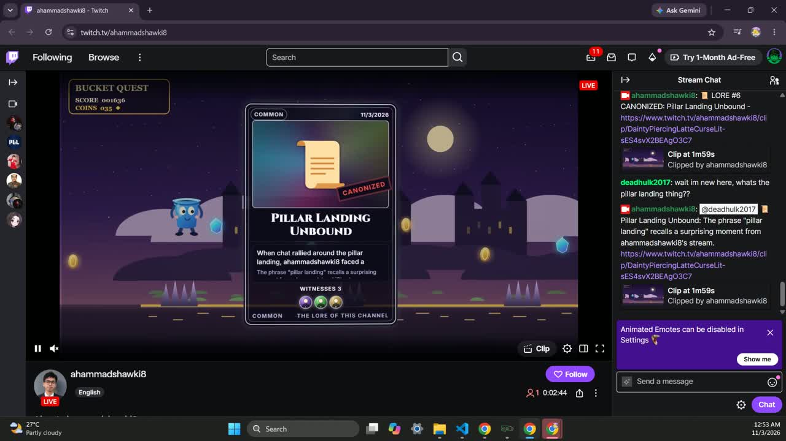
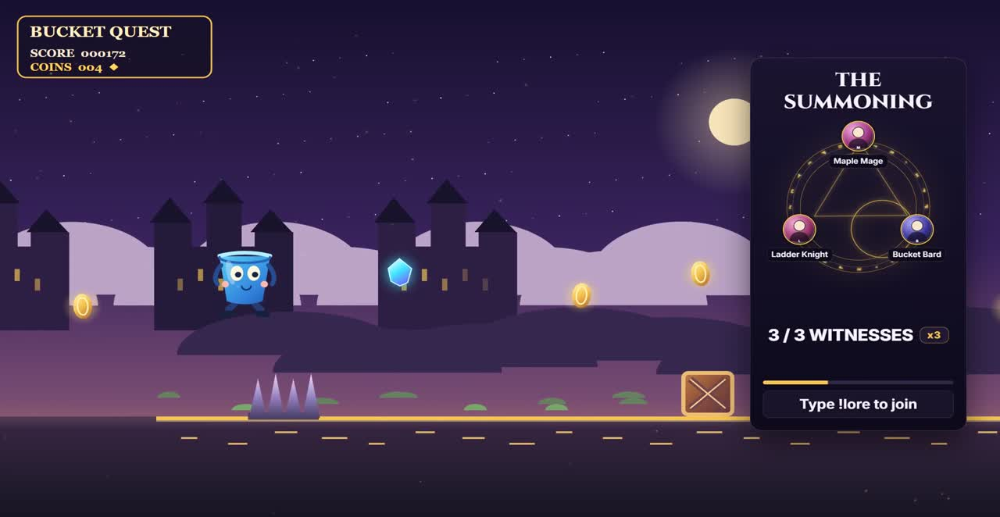
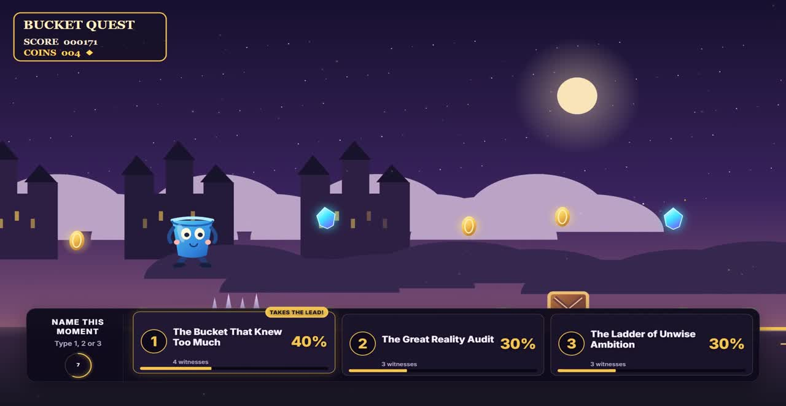
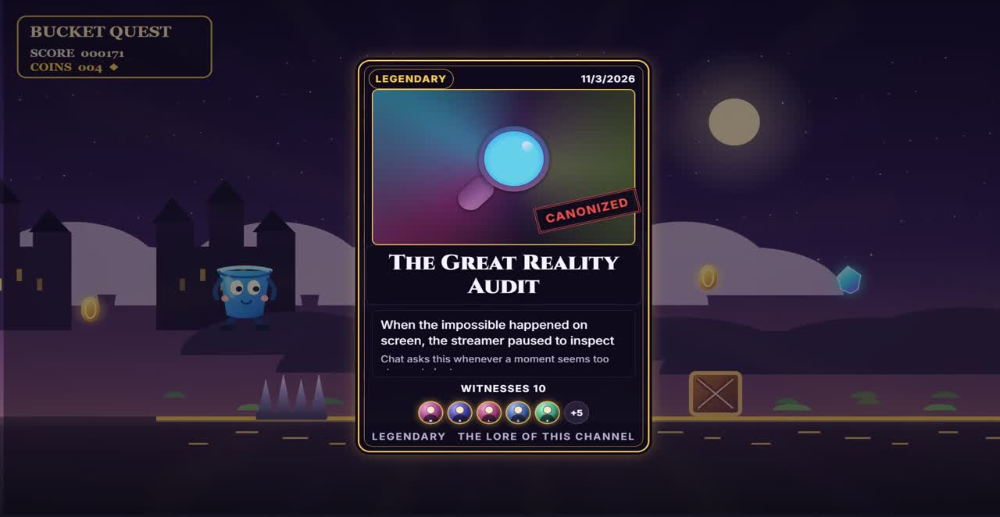
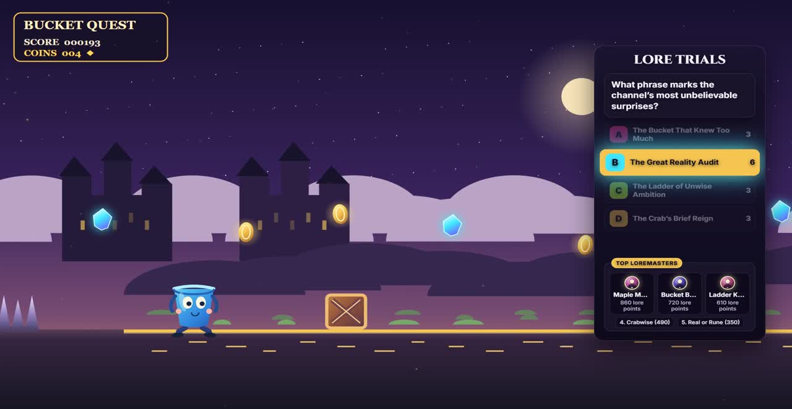
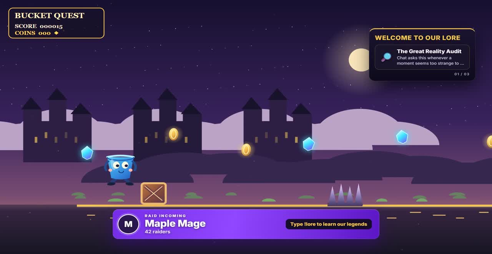
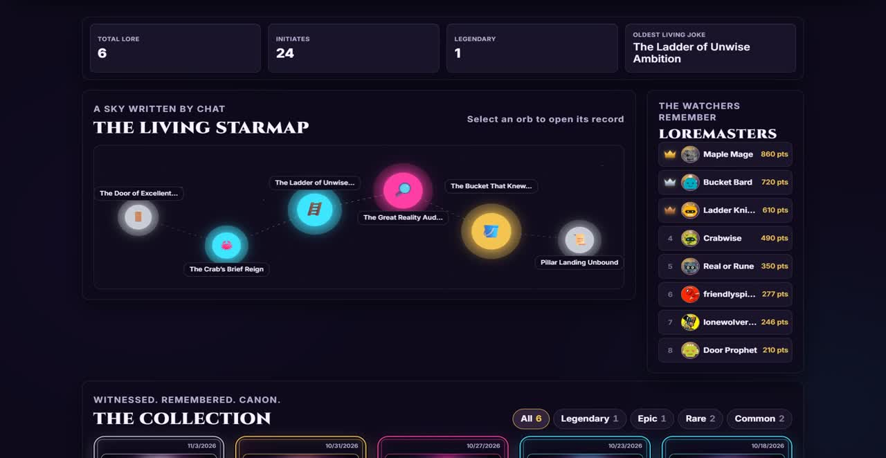
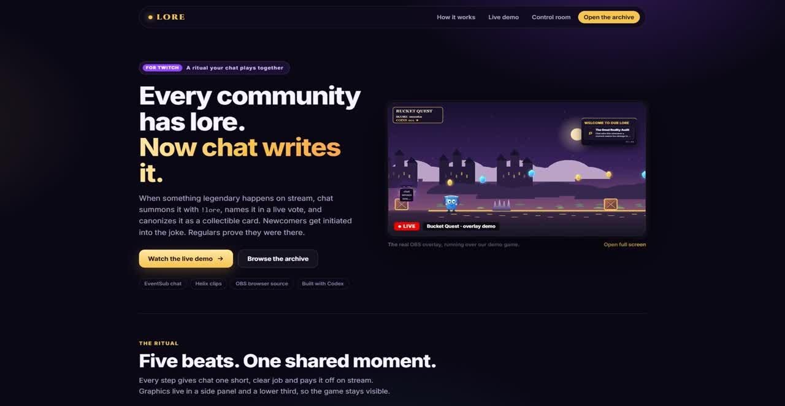

# LORE

Every community has lore. Now chat gets to write it.

LORE is a Twitch companion that turns memorable chat moments into community canon. Viewers summon moments, help shape their titles through a live vote, and see the winners preserved in a growing archive. Newcomers can discover community references through initiation, while regulars compete in lore trials.

## The Ritual

1. **Summon:** Viewers type `!lore` to gather witnesses around a moment.
2. **Decipher:** LORE reviews recent chat, creates a clip when Twitch can provide one, and drafts three possible titles. AI-written drafts are optional.
3. **Vote:** Chat chooses the title by sending `1`, `2`, or `3`.
4. **Canonize:** The winning title and story become a permanent archive entry, revealed on stream as a collectible LORE card.
5. **Initiate:** Newcomers can ask what a community reference means or use `!lore <phrase>` to learn its meaning.
6. **Trials:** A broadcaster or moderator can start a quiz. Chat answers A, B, C, or D, and correct answers earn Loremaster points.
7. **Recall:** When three chatters repeat a canonized phrase, LORE shows a "Lore recalled" chip so old jokes stay alive.
8. **Raid welcome:** Incoming raiders get a Twitch-purple raid alert and a panel dealing the channel's top 3 lore cards, with a chat invite to type `!lore`.
9. **Archive:** The public archive presents entries as a living starmap and a collectible card binder, with stories, real clips, witnesses, usage, and Loremasters.

**Rarity is participation:** every summoner and voter is printed on the card as a witness. 1 to 3 witnesses mint a Common card, 4 to 6 Rare, 7 to 9 Epic, 10+ Legendary.

**Broadcast layout:** graphics live in a right-side panel (summon, trials, raid lore) and a lower third (vote, initiation, raid alert). Only the canonization reveal takes center stage, for a few seconds.

## See it live



*A real run on twitch.tv/ahammadshawki8: chat summoned the moment, voted on its name, and LORE canonized it with an auto-created Twitch clip.*

| Summon (right panel) | Vote (lower third) |
| --- | --- |
|  |  |
| **Canonization (center stage)** | **Lore Trials** |
|  |  |
| **Raid welcome** | **The archive** |
|  |  |



## Architecture

```text
Twitch EventSub
      |
      v
src/twitch.js -- chat events --> ritual / initiation / trials / detector
      |                                      |
      | Helix                                | JSON files in data/
      v                                      v
  Twitch API                           LORE archive and scores
                                             |
                                             v
                                  Express API + WebSocket /ws
                                  /          |           \
                                 v           v            v
                            OBS overlay   Control room   Archive page
```

### Twitch integration

- EventSub WebSocket subscription to `channel.chat.message`.
- Helix Send Chat Message (`POST /helix/chat/messages`).
- Helix Create Clip and clip lookup (`POST /helix/clips`, `GET /helix/clips`). Clip creation is best effort, rituals can continue without a clip.
- Helix Get Users for chatter profile images.
- Helix Get Streams and Get Channels for stream context.

## Setup

Requirements: Node.js 20 or newer and npm.

1. Generate a Twitch token with [twitchtokengenerator.com](https://twitchtokengenerator.com/). Choose **Custom Scope Token** and request `user:read:chat user:write:chat user:bot clips:edit`.
2. Copy `.env.example` to `.env`. Set `ACCESS_TOKEN` and `CLIENT_ID`. `REFRESH_TOKEN` is included as a reference value, `PORT` defaults to `3000`, and `OPENAI_API_KEY` is optional.
3. Install dependencies with `npm install`.
4. Add sample lore and Loremasters with `npm run seed`.
5. Start LORE with `npm start`, then open `http://localhost:3000`.

### OBS Browser Source

Add a Browser Source and set its URL to `http://localhost:3000/overlay.html`. Set the width to **1920** and height to **1080**. Enable **Control audio via OBS** on the source to route overlay sound through OBS. To enable the overlay's sound prompt, add `?sound=1` to the URL.

## AI and offline mode

Set `OPENAI_API_KEY` to let LORE draft titles and stories with OpenAI. Without the key, LORE uses a deterministic local draft and the ritual still works.

To preview without Twitch credentials, start the local server and open `http://localhost:3000/overlay.html?demo=1&bg=1`. The Control room at `http://localhost:3000/control.html` includes simulators for summoners, votes, trial answers, newcomer questions, and custom chat crowds. With no token, Twitch chat announcements and profile lookups are unavailable, but local simulations and archive behavior remain available.

## How we built it with Codex

LORE was built in one Codex thread (Codex CLI, session `01a19d28-4159-73c3-bd36-d3f64e531f16`), one focused prompt at a time. Every prompt is committed in [`codex-prompts/`](codex-prompts/) in order:

| Step | Prompt | What Codex built |
| --- | --- | --- |
| 1 | `01-scaffold-twitch` | EventSub WebSocket chat, Helix chat, clips, users, streams |
| 2 | `02-ritual-engine` | Ritual state machine, chat pressure detector, simulators, offline smoke test |
| 3 | `03-initiation-trials` | Newcomer initiation, Lore Trials, Loremasters, seed data |
| 4 | `04` to `04d` | The OBS overlay, then three visual review rounds driven by real screenshots |
| 5 | `05`, `07`, `07b`, `12` | Archive starmap and card binder, control room |
| 6 | `06-hardening-readme` | Race fixes, atomic writes, reconnects, docs |
| 7 | `08-stage-game` | Bucket Quest, an original demo game for streams |
| 8 | `09` to `11` | Naming fallback after a live test, design system pass, broadcast layout |
| 9 | `13-raid-welcome-recall` | Raid EventSub welcome and lore recall |

Codex followed project rules kept in [`AGENTS.md`](AGENTS.md), and every step ended with `npm run smoke`, an offline test that plays a full ritual, initiation, trial, recall and raid with stubbed Twitch calls. Between Codex steps we reviewed screenshots of every scene at 1920x1080 and polished layout and readability by hand (for example `public/overlay.polish.css`).

## License

LORE is released under the MIT License. See [LICENSE](LICENSE).
