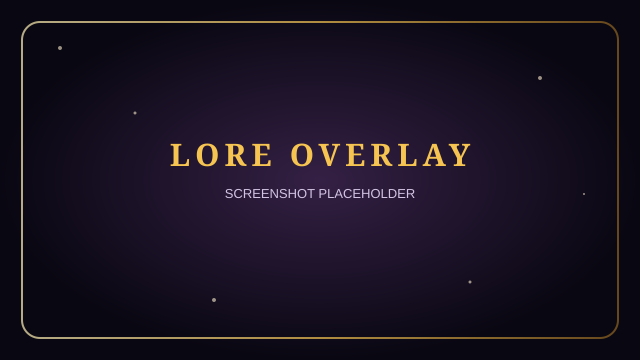
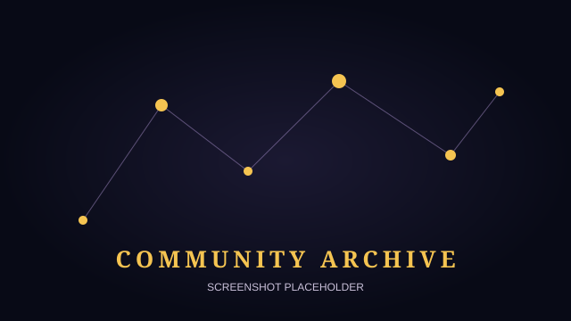
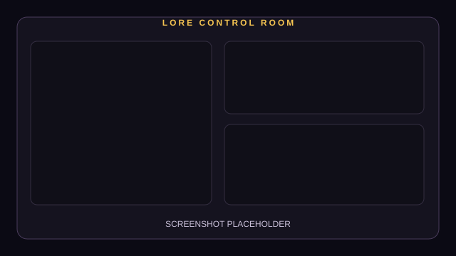

# LORE

Every community has lore. Now chat gets to write it.

LORE is a Twitch companion that turns memorable chat moments into community canon. Viewers summon moments, help shape their titles through a live vote, and see the winners preserved in a growing archive. Newcomers can discover community references through initiation, while regulars compete in lore trials.

## The Ritual

1. **Summon:** Viewers type `!lore` to gather witnesses around a moment.
2. **Decipher:** LORE reviews recent chat, creates a clip when Twitch can provide one, and drafts three possible titles. AI-written drafts are optional.
3. **Vote:** Chat chooses the title by sending `1`, `2`, or `3`.
4. **Canonize:** The winning title and story become a permanent archive entry, revealed on stream as a collectible LORE card.
5. **Initiate:** Newcomers can ask what a community reference means or use `!lore <phrase>` to learn its meaning.
6. **Trials:** A broadcaster or moderator can start a quiz. Chat answers A, B, C, or D, and correct answers earn Loremaster points.
7. **Codex:** The public archive presents entries as a constellation, with stories, clips, witnesses, usage, and Loremasters.

## Screenshots and GIF

The following placeholders are ready to replace with captures from a live setup:

| Overlay | Community archive | Control room |
| --- | --- | --- |
|  |  |  |

Add a short ritual capture at `docs/ritual-demo.gif` when one is available. Capture guidance is in [docs/SCREENSHOTS.md](docs/SCREENSHOTS.md).

## Architecture

```text
Twitch EventSub
      |
      v
src/twitch.js -- chat events --> ritual / initiation / trials / detector
      |                                      |
      | Helix                                | JSON files in data/
      v                                      v
  Twitch API                           LORE archive and scores
                                             |
                                             v
                                  Express API + WebSocket /ws
                                  /          |           \
                                 v           v            v
                            OBS overlay   Control room   Archive page
```

### Twitch integration

- EventSub WebSocket subscription to `channel.chat.message`.
- Helix Send Chat Message (`POST /helix/chat/messages`).
- Helix Create Clip and clip lookup (`POST /helix/clips`, `GET /helix/clips`). Clip creation is best effort, rituals can continue without a clip.
- Helix Get Users for chatter profile images.
- Helix Get Streams and Get Channels for stream context.

## Setup

Requirements: Node.js 20 or newer and npm.

1. Generate a Twitch token with [twitchtokengenerator.com](https://twitchtokengenerator.com/). Choose **Custom Scope Token** and request `user:read:chat user:write:chat user:bot clips:edit`.
2. Copy `.env.example` to `.env`. Set `ACCESS_TOKEN` and `CLIENT_ID`. `REFRESH_TOKEN` is included as a reference value, `PORT` defaults to `3000`, and `OPENAI_API_KEY` is optional.
3. Install dependencies with `npm install`.
4. Add sample lore and Loremasters with `npm run seed`.
5. Start LORE with `npm start`, then open `http://localhost:3000`.

### OBS Browser Source

Add a Browser Source and set its URL to `http://localhost:3000/overlay.html`. Set the width to **1920** and height to **1080**. Enable **Control audio via OBS** on the source to route overlay sound through OBS. To enable the overlay's sound prompt, add `?sound=1` to the URL.

## AI and offline mode

Set `OPENAI_API_KEY` to let LORE draft titles and stories with OpenAI. Without the key, LORE uses a deterministic local draft and the ritual still works.

To preview without Twitch credentials, start the local server and open `http://localhost:3000/overlay.html?demo=1&bg=1`. The Control room at `http://localhost:3000/control.html` includes simulators for summoners, votes, trial answers, newcomer questions, and custom chat crowds. With no token, Twitch chat announcements and profile lookups are unavailable, but local simulations and archive behavior remain available.

## How we built it with Codex

LORE was built step by step in one Codex thread. The implementation prompts are preserved in [`codex-prompts/`](codex-prompts/) so the project can be reviewed as a sequence of focused changes.

## License

LORE is released under the MIT License. See [LICENSE](LICENSE).
